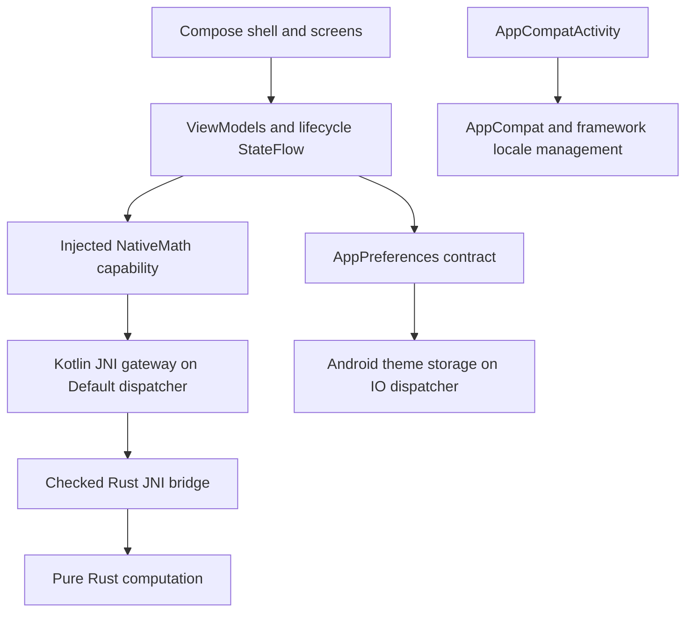

# Architecture

DeviceAtlas keeps one Android Gradle module (`:app`) and one Rust crate
(`native`, library `deviceatlas_core`). Package boundaries provide sufficient
separation for Phase 1; no generic repository or pass-through use case is needed.

```text
app/src/main/java/io/github/masoudd2159/deviceatlas/
  MainActivity.kt                 AppCompat, locale actions, application theme
  DeviceAtlasApplication.kt       Hilt application
  foundation/                    NativeMath/results, preference contracts/enums
  data/nativecore/               JNI gateway and bridge declarations
  data/preferences/              Android-only, off-main theme persistence
  di/                            Capability bindings and qualified dispatchers
  presentation/
    theme/                       Existing theme extended with semantic tokens
    components/                  Stateless shared UI and bounded content
    home/                        Preserved Rust verification state and presentation
    navigation/                  Serializable keys and top-level stack policy
    settings/                    Application appearance state owner
    shell/                       Adaptive shell and structural destinations
native/src/
  lib.rs                         Pure mean, numerical regression tests
  bridge.rs                      Checked JNI array/status protocol
```



Only Diagnostics creates `HomeViewModel`, scoped to its Navigation 3 entry. Native
verification does not block application startup and never runs in recomposition.
`SettingsViewModel` is Activity-scoped because theme controls the complete app.
Both use `viewModelScope`; Compose observes with `collectAsStateWithLifecycle`.
No Activity/Context enters either ViewModel. Android storage receives only an
application Context. No custom global coroutine scope is introduced.

Bindings are unscoped: gateway and preferences adapters are cheap, stateless
capability implementations. Application appearance has exactly one ViewModel
owner. Qualified `Default` and `IO` dispatchers make work placement explicit and
allow fakes in unit tests. No additional singleton cache or domain engine exists.

Future hardware features should add an Android data source, platform-neutral
input, Rust processing and typed output, then presentation state. Do not bypass
Rust with duplicate Kotlin business calculations or call framework APIs in Rust.

See [Rust boundaries](rust-first-boundaries.md), [navigation](navigation.md),
[design system](design-system.md), [localization](localization.md) and
[decisions](decisions.md).
