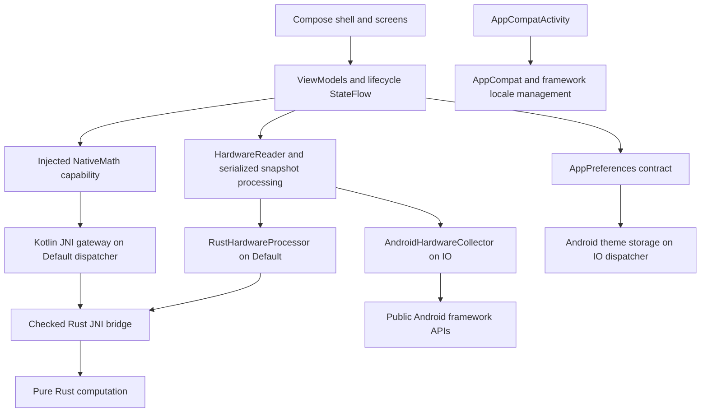

# Architecture

DeviceAtlas keeps one Android Gradle module (`:app`) and one Rust crate
(`native`, library `deviceatlas_core`). Package boundaries provide sufficient
separation for Phase 2; no generic repository or pass-through use case is needed.

```text
app/src/main/java/io/github/masoudd2159/deviceatlas/
  MainActivity.kt                 AppCompat, locale actions, application theme
  DeviceAtlasApplication.kt       Hilt application
  foundation/                    NativeMath/results, preference contracts/enums
    hardware/                    Typed availability, sources/freshness, raw and processed data
  data/nativecore/               JNI gateway and bridge declarations
  data/preferences/              Android-only, off-main theme persistence
  data/hardware/                 Public Android snapshots, field isolation, processing orchestration
  di/                            Capability bindings and qualified dispatchers
  presentation/
    theme/                       Existing theme extended with semantic tokens
    components/                  Stateless shared UI and bounded content
    home/                        Preserved Rust verification state and presentation
    hardware/                    Shared snapshot state and lazy information/sensor screens
    navigation/                  Serializable keys and top-level stack policy
    settings/                    Application appearance state owner
    shell/                       Adaptive shell and connected information destinations
native/src/
  lib.rs                         Pure mean, numerical regression tests
  bridge.rs                      Checked JNI array/status protocol
  hardware.rs                    Pure hardware numeric validation and derived metrics
```



Only Diagnostics creates `HomeViewModel`, scoped to its Navigation 3 entry. Native
verification does not block application startup and never runs in recomposition.
`SettingsViewModel` is Activity-scoped because theme controls the complete app.
`HardwareViewModel` is Activity-scoped to share one in-memory foreground snapshot
across information tabs and rotation. All use `viewModelScope`; Compose observes
with `collectAsStateWithLifecycle`. No Activity/Context enters a ViewModel. Android storage receives only an
application Context. No custom global coroutine scope is introduced.

Native gateways and preferences adapters are unscoped and cheap. The hardware
collector and reader are process singletons: the collector caches successful
session metadata, and the reader serializes collection with a mutex. Appearance
and hardware each have one Activity ViewModel owner. Qualified `Default` and `IO`
dispatchers make work placement explicit and allow fakes in unit tests.

Further hardware fields extend the collector, platform-neutral
input, Rust processing and typed output, then presentation state. Do not bypass
Rust with duplicate Kotlin business calculations or call framework APIs in Rust.

See [Rust boundaries](rust-first-boundaries.md), [navigation](navigation.md),
[design system](design-system.md), [localization](localization.md) and
[decisions](decisions.md), [hardware sources/models](hardware-collection.md), and
[native hardware protocol](native-hardware-processing.md).

Phase 3 adds an independent Activity-owned `MonitoringViewModel` and a bounded
`MonitoringSession`. It never turns HardwareViewModel refresh into polling.
The shell combines Diagnostics visibility with Activity RESUMED outside retained
navigation entries, stopping on either gate's loss without automatic resume.
AndroidMonitoringSource acquires public observations on IO; RustMonitoringProcessor
validates/derives/summarizes them on Default through a separate versioned JNI ABI.
See [foreground monitoring](foreground-monitoring.md) and
[native monitoring processing](native-monitoring-processing.md).

Phase 4 adds an independent Activity-owned `BenchmarkViewModel` and foreground
`BenchmarkSession`, selected within Diagnostics. Typed contracts live under
`foundation/benchmark`, platform preflight under `data/benchmark`, native transport
in `RustBenchmarkProcessor`, and bounded algorithms/statistics in
`native/src/benchmark.rs`. A process-local `DiagnosticsCoordinator` guards leases
across both session types and retiring owners; it has no worker or scope.
`ThermalHeadroomReader` shares one ten-second cache between diagnostic collectors.
See [safe benchmarking](safe-benchmarking.md),
[native benchmark processing](native-benchmark-processing.md), and
[Phase 4 evidence](../phase-4-report.md).
